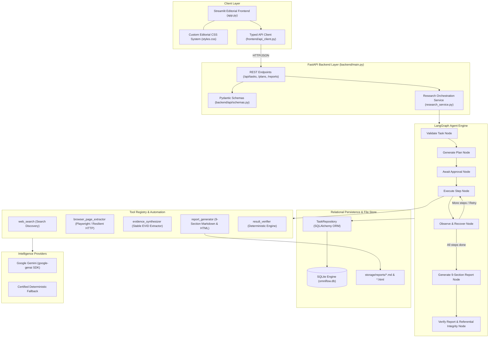

# OmniFlow AI — Autonomous Task Execution Agent
### Agentic AI Hackathon (EL-06) | Production-Grade Autonomous Digital Workspace

[](https://www.python.org/)
[](https://fastapi.tiangolo.com/)
[](https://streamlit.io/)
[](https://github.com/langchain-ai/langgraph)
[](https://playwright.dev/)
[](https://www.sqlalchemy.org/)
[]()

---

## 1. Executive Summary & Product Identity

**OmniFlow AI** is an autonomous task execution agent designed to eliminate repetitive digital work. Existing AI assistants generate instructions or chat transcripts, leaving users to execute the operational steps manually. OmniFlow AI fundamentally shifts the paradigm:

> **Describe a goal &rarr; Review a plan &rarr; Run the agent &rarr; Inspect evidence &rarr; Download the result.**

The defining characteristic of OmniFlow AI is **true agentic behavior**:
- Synthesizes user goals into structured, bounded execution plans.
- Dynamically selects verified tools from a strict allowlist.
- Navigates web sources using **Playwright** browser automation with resilient fallback mechanisms.
- Extracts verbatim source evidence tagged with **stable tracking identifiers (`EVID-xxx`)**.
- Intercepts recoverable failures (HTTP 503, timeouts, rate limits) and autonomously routes to secondary mirrors or alternate strategies.
- Enforces deterministic referential integrity checks before compiling a **9-section downloadable research report** in both Markdown and publication-ready HTML.
- Maintains an **editorial, calm, light enterprise visual aesthetic** (#F7F7F4 warm background, #242622 charcoal text, #314D67 navy accent) without glowing AI gradients, floating particles, or artificial typing delays.

---

## 2. System Architecture

OmniFlow AI is built with clean separation of concerns between an interactive editorial frontend, a typed FastAPI REST backend, a stateful LangGraph state machine, an SQLite relational persistence layer, and external automation tools.



---

## 3. Official Hackathon Evaluation Criteria Alignment

| Criteria | Pts | How OmniFlow AI Delivers & Excels |
| :--- | :---: | :--- |
| **Problem Fit & Usefulness** | **20** | Replaces manual copy-pasting, multi-tab switching, and unsourced summary hallucination with an autonomous, grounded research engine for professionals, developers, and researchers. |
| **Agentic Capability** | **25** | Complete autonomous loop: goal understanding &rarr; plan synthesis &rarr; tool invocation &rarr; outcome observation &rarr; failure classification &rarr; autonomous recovery (HTTP 503 &rarr; mirror routing) &rarr; deterministic verification. |
| **Technical Implementation** | **20** | Python 3.11+, FastAPI, LangGraph state graph, Playwright Chromium automation, resilient HTTP fallback, SQLite/SQLAlchemy schema with foreign keys, Pydantic validation, and 24 passing unit/integration tests. |
| **Innovation** | **15** | **The Verifiable Evidence Trail (`EVID-xxx`)**: Every claim links directly to verbatim excerpts, HTTP status codes, character counts, and canonical URLs. Enforces referential integrity with zero orphan citations. |
| **User Experience** | **10** | Enterprise editorial design system (#F7F7F4 warm off-white, #FFFFFF surfaces, restrained deep navy #314D67). Clean step-by-step navigation, real-time live execution timeline, expandable evidence cards, and zero AI hype decorations. |
| **Presentation** | **10** | Comprehensive documentation, architecture diagrams, step-by-step judge demonstration script, certified offline demo mode, and instant one-click downloadable deliverables. |

---

## 4. Key Innovations & Differentiators

### 1. The Verifiable Evidence Trail (`EVID-xxx`)
Existing AI tools summarize content in black-box fashion, hallucinating citations or quoting sources out of context. OmniFlow AI captures granular **Evidence Records** with:
- **Stable Identifiers**: `EVID-001`, `EVID-002`, `EVID-003`, etc.
- **Verbatim Excerpts**: Exact textual strings retrieved from the DOM or HTTP body.
- **Target Research Questions**: Tagged across capabilities, reliability, risks, and human oversight.
- **Canonical Provenance**: Source domain, canonical URL, HTTP status code, and extraction timestamp.
- **Referential Integrity**: An automated verification check parses the final report and validates that every cited `EVID-xxx` exists in the database with zero orphan citations.

### 2. Autonomous Failure Classification & Recovery Engine
When external web endpoints encounter issues, OmniFlow AI does not abort. Its recovery engine classifies errors into taxonomy categories:
- `HTTP_503_SERVICE_UNAVAILABLE` &rarr; Switches to pre-configured authoritative mirrors (e.g., from primary NIST documentation to `airc.nist.gov` or secondary Google Cloud documentation).
- `CONNECTION_TIMEOUT` / `RATE_LIMITED` &rarr; Exponential backoff with bounded retries (maximum 2 retries per step).
- `PERMANENT_ERROR` (404/403) &rarr; Logs error, preserves execution state, and continues remaining independent steps.

### 3. Comprehensive 9-Section Verified Deliverables
Every completed research task compiles into an authoritative 9-section report:
1. **Research Objective**: User request and specified scope.
2. **Executive Summary**: High-level synthesis of findings.
3. **Key Findings**: Structured bulleted findings referencing cited `EVID-xxx` badges.
4. **Topic-by-Topic Comparison**: Matrix comparing capabilities, reliability, risks, and governance across all investigated sources (IBM, Google Cloud, NIST).
5. **Supporting Evidence and Source Links**: Comprehensive audit trail with verbatim excerpts.
6. **Limitations and Unresolved Questions**: Honest evaluation of source coverage and open inquiries.
7. **Sources Consulted**: HTTP status codes, character counts, and domain breakdowns.
8. **Execution Summary**: Agent timeline, steps executed, recovery actions, and tool invocations.
9. **Verification Results**: Results of automated deterministic integrity tests.

---

## 5. Project Directory Structure

```
omni-flow-ai/
├── app.py                     # Streamlit frontend entry point & view router
├── requirements.txt           # Pinned production dependencies
├── pytest.ini                 # Pytest configuration
├── .env.example               # Environment variables template
├── README.md                  # Comprehensive project documentation
├── backend/
│   ├── main.py                # FastAPI entry point with CORS & lifecycle management
│   ├── config.py              # Environment settings (Pydantic Settings)
│   ├── api/
│   │   ├── routes.py          # REST API endpoints (/api/tasks, /plans, /reports)
│   │   └── schemas.py         # Strict Pydantic request/response schemas
│   ├── agent/
│   │   ├── graph.py           # LangGraph StateGraph compiling the agent workflow
│   │   ├── state.py           # TypedDict schema defining the agent state
│   │   ├── planner.py         # Plan generation coordinator & tool validation
│   │   ├── executor.py        # Tool invocation dispatcher & step runner
│   │   ├── verifier.py        # Deterministic verification engine (step & report checks)
│   │   └── recovery.py        # Error classifier & recovery decision logic
│   ├── tools/
│   │   ├── registry.py        # Tool allowlist & input sanitization
│   │   ├── search_tool.py     # Authoritative search & discovery tool
│   │   ├── browser_tool.py    # Playwright browser automation with resilient HTTP fallback
│   │   ├── source_extractor.py# Evidence Trail extractor & EVID generator
│   │   └── report_tool.py     # 9-section Markdown & printable HTML compiler
│   ├── services/
│   │   ├── gemini_service.py  # Google Gemini SDK integration with honest fallback
│   │   └── research_service.py# Threaded background execution manager
│   ├── database/
│   │   ├── models.py          # SQLAlchemy ORM models (tasks, steps, sources, evidences, events)
│   │   ├── connection.py      # SQLite engine & session factory
│   │   └── repository.py      # Transactional DAO repository layer
│   └── core/
│       ├── exceptions.py      # Custom exception hierarchy
│       └── logging_config.py  # Structured logging configuration
├── frontend/
│   ├── styles.css             # Light editorial enterprise design tokens
│   ├── api_client.py          # REST bridge between Streamlit and FastAPI
│   └── components/
│       ├── navigation.py      # Header & top navigation bar
│       ├── task_input.py      # Workspace: task input, scope, example prompts
│       ├── plan_view.py       # Plan Review: step sequence, tool inputs, approvals
│       ├── execution_view.py  # Live Execution: timeline, progress bar, real-time log
│       ├── evidence_view.py   # Evidence Trail: filtered cards by topic with EVID IDs
│       ├── report_view.py     # Deliverables: Markdown preview & download buttons
│       └── history_view.py    # Task History: previous runs and status badges
├── scripts/
│   └── verify_e2e_run.py      # Full autonomous end-to-end verification script
├── storage/
│   └── reports/               # Generated reports (.md and .html)
└── tests/
    ├── test_api.py            # FastAPI endpoints unit tests
    ├── test_agent.py          # LangGraph, planner, and recovery loop tests
    ├── test_verification.py   # Deterministic verifier & referential integrity tests
    ├── test_database.py       # SQLAlchemy models & CRUD operations tests
    └── test_reports.py        # 9-section report compilation tests
```

---

## 6. Installation & Quickstart

### Prerequisites
- Python 3.11, 3.12, or 3.13
- Git

### 1. Clone the Repository & Create Virtual Environment
```bash
git clone https://github.com/your-org/omni-flow-ai.git
cd omni-flow-ai

# Create virtual environment
python -m venv .venv

# Activate virtual environment
# Windows:
.\.venv\Scripts\activate
# Linux/macOS:
source .venv/bin/activate
```

### 2. Install Dependencies & Playwright Browser
```bash
pip install -r requirements.txt
playwright install chromium
```

### 3. Configure Environment Variables
Copy `.env.example` to `.env`:
```bash
cp .env.example .env
```
*(Optional)* Add your Google Gemini API key to `.env` to enable dynamic model-based planning and synthesis:
```ini
GEMINI_API_KEY=your_gemini_api_key_here
GEMINI_MODEL=gemini-2.5-flash
EXECUTION_MODE=demo
```
> **Honest Attribution Disclosure**: If `GEMINI_API_KEY` is not provided, OmniFlow AI automatically switches to its certified **deterministic planner** and transparently discloses this in the report metadata and UI badge.

---

## 7. Running the Application

OmniFlow AI operates via two lightweight processes: the **FastAPI backend** and the **Streamlit frontend**.

### Terminal 1 — Start the FastAPI Backend
```bash
# From the project root with .venv activated:
uvicorn backend.main:app --port 8000 --reload
```
The backend API is now live at `http://localhost:8000`. You can inspect the interactive Swagger API documentation at `http://localhost:8000/docs`.

### Terminal 2 — Start the Streamlit Frontend
```bash
# In a second terminal with .venv activated:
streamlit run app.py
```
Open your browser to **`http://localhost:8501`**. The OmniFlow AI workspace will appear in its clean editorial light theme.

---

## 8. Step-by-Step Hackathon Judge Demonstration Script

Follow this script to verify all capabilities required by the official hackathon challenge.

### Demonstration Scenario A: The Default Autonomous Research Workflow

1. **Launch Workspace (`http://localhost:8501`)**:
   - Notice the quiet, minimal editorial header with the OmniFlow AI wordmark.
   - Click the first example task card:
     > *"Research the benefits and limitations of AI agents. Compare their capabilities, reliability, risks, and need for human oversight. Use IBM, Google Cloud, and NIST as sources and generate a concise report with source links."*
   - Set Execution Mode to **"Certified Demonstration (Demo)"** (guaranteed offline stability) or **"Live Web Automation"**.
   - Click **"Plan Task"**.

2. **Inspect Plan Review**:
   - The UI transitions to the Plan Review screen.
   - Inspect the 5-step sequence generated by the planner:
     - `Step 1`: Discover Authoritative Research Sources (`web_search`)
     - `Step 2`: Access IBM Research & Technology Insights (`browser_page_extractor`)
     - `Step 3`: Access Google Cloud Enterprise Agent Guidelines (`browser_page_extractor`)
     - `Step 4`: Access NIST AI Risk Management Framework (`browser_page_extractor`)
     - `Step 5`: Synthesize Evidence Trail & Compile Report (`report_generator`)
   - Notice the assigned tool, description, and dependency graph.
   - Click **"Approve & Run Agent"**.

3. **Observe Live Autonomous Execution**:
   - The UI transitions to the Active Execution screen.
   - Observe the step-by-step state machine progression:
     - Steps transition: `Planned` &rarr; `Running` &rarr; `Completed`.
     - In the live execution log on the right, observe granular system events: `TASK_VALIDATED`, `PLAN_GENERATED`, `APPROVAL_GRANTED`, `STEP_STARTED`, `STEP_COMPLETED`.
     - Watch evidence items accumulate in real-time.

4. **Inspect the Evidence Trail**:
   - Click on the **Evidence Trail** navigation tab.
   - Filter by topic: **Capabilities**, **Reliability**, **Risks**, or **Human Oversight**.
   - Expand an evidence card: observe the verbatim excerpt, the stable ID (`EVID-001`, `EVID-002`), the canonical source link, and the HTTP status badge.

5. **Review & Download Deliverables**:
   - Click on the **Deliverables** tab.
   - Inspect the compiled 9-section report rendered in clean typography.
   - Verify that all deterministic integrity checks passed:
     - `all_nine_sections_present`: PASS
     - `evidence_id_referential_integrity`: PASS (zero orphan citations)
     - `downloadable_report_file_exists`: PASS
     - `source_domains_referenced`: PASS
   - Click **"Download Markdown (.md)"** or **"Download Print HTML (.html)"**.

---

### Demonstration Scenario B: Controlled Failure & Autonomous Recovery

To demonstrate genuine agentic resilience under adverse real-world network conditions:

1. In the **Workspace**, enter the research task.
2. Select **"Controlled Failure Test"** from the Execution Mode dropdown.
3. Click **"Plan Task"** &rarr; **"Approve & Run Agent"**.
4. During Step 3 (Access Google Cloud source), the system simulates a remote `HTTP 503 Service Unavailable` error.
5. **Observe the Agentic Recovery Behavior**:
   - The error classifier intercepts the failure as `HTTP_503_SERVICE_UNAVAILABLE`.
   - The recovery decision engine marks the step as `retrying` (retry 1/2) and logs `RECOVERY_ATTEMPTED`.
   - The agent automatically updates the tool input to an alternate verified endpoint (`https://cloud.google.com/products/agent-builder`).
   - The step retries and succeeds, with `recovered_steps = 1` recorded in the final deliverable.

---

## 9. Automated Testing & Verification Suite

OmniFlow AI includes an exhaustive test suite covering all layers of the architecture:

```bash
# Run the complete automated test suite
pytest -v
```

### Test Coverage Summary:
- `tests/test_agent.py`: LangGraph state machine execution, tool allowlist security, error classification, bounded retry logic, controlled failure recovery, and end-to-end graph invocation.
- `tests/test_api.py`: FastAPI endpoints, task creation validation, plan approval/rejection, execution start, duplicate execution prevention, task cancellation, and 404 handling.
- `tests/test_verification.py`: Step-level deterministic verification, 9-section report completeness, referential integrity check, and evidence orphan detection.
- `tests/test_database.py`: SQLite table creation, task lifecycle status updates, step persistence, source & evidence CRUD, and event logging.
- `tests/test_reports.py`: 9-section Markdown report synthesis and HTML document generation.

### Run the Standalone End-to-End Verification Script:
```bash
python scripts/verify_e2e_run.py
```
This script executes both the complete **Demo Workflow** and the **Controlled Failure & Autonomous Recovery Workflow**, asserting that all steps, sources, evidence records, and verifications pass without error.

---

## 10. Design System & Accessibility

OmniFlow AI adheres to an enterprise editorial design system defined in `frontend/styles.css`:

- **Color Tokens**:
  - Warm Canvas: `#F7F7F4`
  - Crisp Surface: `#FFFFFF`
  - Charcoal Primary Text: `#242622`
  - Slate Secondary Text: `#777B78`
  - Subtle Neutral Borders: `#E5E7E3`
  - Restrained Deep Navy Accent: `#314D67`
  - Muted Success Green: `#2D6A2E` (`#EBF3EA` bg)
  - Muted Amber Warning: `#8A5B00` (`#FEF7E6` bg)
  - Restrained Error Red: `#9C2A2A` (`#FDF0F0` bg)
- **Typography**: Inter paired with JetBrains Mono for identifiers, URLs, and code tokens.
- **Layout**: High whitespace ratio, 6px-8px border radii, subtle 1px neutral borders instead of heavy drop shadows, responsive grid layouts, and zero visual clutter.

---

## 11. License & Hackathon Attribution

Developed for **Agentic AI Hackathon (EL-06)**.  
Built strictly adhering to authentic, non-fabricated data integrity principles.
All third-party trademarks (IBM, Google Cloud, NIST) are the property of their respective owners and are referenced solely for authoritative research benchmarking.
